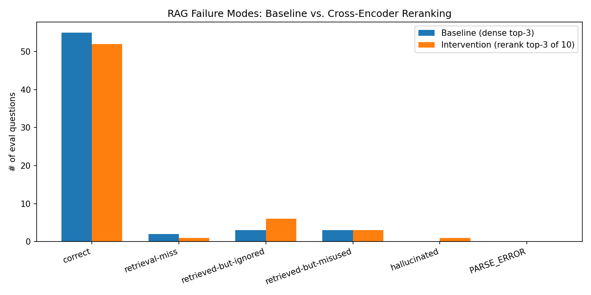

# RAG Failure-Mode Analysis — Python Stdlib Docs

A fully local, no-paid-API RAG pipeline built on free-tier Colab (T4 GPU), instrumented to
classify *why* answers go wrong — not just whether they're right — and used to test whether
cross-encoder reranking actually helps a small local generator.

**The headline finding:** reranking *did not* improve answer quality on this corpus, and in fact
regressed it slightly (87.3% → 82.5% correct) — because the weak 3B generator turned out to be
sensitive to *which* passages accompanied the right one in context, not just whether the right
passage was retrieved at all. The bottleneck here was the generator, not the retriever, and this
project's failure-mode taxonomy is what surfaced that.

## Results



| | Baseline (dense top-3) | Intervention (rerank top-3 of 10) |
|---|---|---|
| Correct | 55/63 (87.3%) | 52/63 (82.5%) |
| Retrieval-miss | 2/63 | 1/63 |
| Retrieved-but-ignored | 3/63 | 6/63 |
| Retrieved-but-misused | 3/63 | 3/63 |
| Hallucinated | 0/63 | 1/63 |

- Reranking **did** fix the one retrieval-miss it could reach (gold chunk was in the dense top-10,
  just outside the top-3) — confirming the mechanism works as designed.
- It could **not** fix the other miss, because that gold chunk wasn't in the top-10 candidate pool
  at all — a hard limit of reranking as an intervention, not a bug.
- Of 5 questions that changed category between phases, 4 were *regressions*: reranking swapped in
  different distractor chunks alongside the correct one, and the 3B generator's answer quality was
  sensitive to that swap even when the right chunk was present both times.
- A manual spot-check of 18 stratified judgments against a local Qwen2.5-7B judge found **83.3%
  human agreement** — solid, but the disagreements clustered specifically at the
  `retrieved-but-misused` vs. `hallucinated` boundary, so the single `hallucinated` count above
  should be read with a grain of salt (full breakdown below).

## How it works

```
Python stdlib docs (os, itertools, collections, re, json, functools)
        │  scrape + chunk at the function/class/exception level
        ▼
   corpus.json  →  embed (all-MiniLM-L6-v2, CPU)  →  FAISS index (in-memory, CPU)
        │
        ▼
63-question eval set (gold answer + gold doc-section id per question, hand-verified against docs)
        │
        ├─ Baseline: dense top-3 retrieval → Qwen2.5-3B-Instruct generation (4-bit)
        │                                  → Qwen2.5-7B-Instruct judge (4-bit), 5-way rubric
        │
        └─ Intervention: dense top-10 → cross-encoder rerank → top-3 → same gen/judge pipeline
        ▼
  before/after comparison + manual spot-check of judge reliability
```

Everything runs on a free Colab T4: embedding and reranking on CPU, one 4-bit model on GPU at a
time (generator and judge are swapped in/out, never co-resident), all intermediate state
checkpointed to Google Drive so the eval loop survives a session disconnect.

## Key design decisions

- **Objective retrieval-miss detection.** Rather than asking an LLM judge to decide whether
  retrieval "missed," each eval question carries a `gold_section_id` that must exactly match a
  real corpus chunk id. If that id isn't in the retrieved set, the case is labeled
  `retrieval-miss` programmatically — no LLM judgment involved. The judge only classifies the
  remaining four categories, for cases where the gold chunk actually made it into context. This
  is more rigorous than an all-LLM-judged pipeline for a corpus where facts are directly
  verifiable against source documentation.
- **Cross-scale, not same-model, judge.** The judge is a larger model (7B) than the generator
  (3B) rather than the same model judging its own output, since self-judging tends to under-detect
  a model's own reasoning errors. (Originally spec'd as a cross-*family* pairing — Llama generator
  / Qwen judge — but Llama-3.2-3B-Instruct is gated on Hugging Face and requires manual license
  acceptance; swapped to Qwen2.5-3B-Instruct, which is ungated. Noted as a limitation: both models
  are now Qwen-family, just different scale.)
- **A deliberately weak generator.** A 3B model was chosen over a larger one specifically because
  a stronger generator would answer most stdlib-lookup questions correctly regardless of retrieval
  quality, producing a boring, mostly-correct distribution. The 3B model actually populates the
  interesting failure categories.
- **Reranking over chunk-size changes or BM25 hybrid**, because it's a pure post-retrieval step
  that never touches the FAISS index — isolates the intervention's effect cleanly instead of
  conflating it with a rebuilt index.

## Full analysis

**Overall shift.** Total `correct` dropped from 55/63 (87.3%) to 52/63 (82.5%). Reranking did not
net-improve answer quality on this corpus/eval-set combination.

**Retrieval-miss.** Fell as expected, 2/63 → 1/63. The recovered case (`q010`, a `re.match`
case-insensitivity question) had its gold chunk outside the baseline top-3 but present in the
dense top-10 — reranking correctly promoted it. The unrecovered case (`q036`, `re.escape`) never
surfaced even after reranking, meaning its gold chunk likely wasn't in the top-10 pool at all —
the exact failure mode reranking structurally cannot address.

**Ignored vs. misused — the real story.** Five questions changed category between phases:
- `q010`: retrieval-miss → retrieved-but-ignored — retrieval was fixed, but the generator then
  failed to use the newly-available chunk. Net effect: no improvement, just a different failure.
- `q004`, `q059`: correct → retrieved-but-ignored — gold chunk was retrieved fine both times;
  reranking changed which *other* chunks accompanied it, and the altered distractor context was
  apparently enough to make the generator miss an answer it had previously gotten right.
- `q057`: correct → retrieved-but-misused — same pattern, different failure type.
- `q058`: retrieved-but-misused → hallucinated — got strictly worse in kind, not just outcome.

Four of five swaps were regressions; only `q010` was a genuine fix. This is the project's core
takeaway: reranking changed the composition of the context window, and the 3B generator was
sensitive to that composition in ways that sometimes hurt more than the improved ranking helped —
evidence that the generator, not the retriever, was the binding constraint for a meaningful share
of these cases.

**Judge reliability.** Manual spot-check of 18 stratified items: 15/18 agreement (83.3%) with a
human reviewer. All three disagreements were adjacent-category boundary calls, not wild misses:

| id | judge said | human said |
|---|---|---|
| q001 (baseline) | retrieved-but-ignored | retrieved-but-misused |
| q006 (baseline) | retrieved-but-misused | correct |
| q058 (intervention) | hallucinated | retrieved-but-misused |

83.3% is "directionally correct, flag the confusion pattern" territory rather than "fully
reliable." The `misused` vs. `hallucinated` boundary is the confirmed soft spot (shows up in both
`q001` and `q058`), so the single intervention-phase `hallucinated` count should be read with a
grain of salt — it's plausible the true count is 0 and that item is actually `retrieved-but-misused`.

**Limitations.** With 63 questions and single-digit category counts, each category swap moves a
percentage point by roughly 1.6 points — the entire "intervention got worse" headline rests on a
net swing of 3 questions out of 63, within the range a stricter/looser judge or a different
generation seed could plausibly reverse. This is a methodology demonstration of how to structure
and instrument a RAG failure-mode eval, not a statistically powered claim that reranking hurts
small-model RAG pipelines in general. A natural follow-up: scale up the eval set and/or run
multiple generation seeds per phase to see whether the regression replicates.

## Run it yourself

- `rag_failure_modes_experiment.ipynb` — open in Colab, set runtime to T4 GPU, run top to bottom.
  Fully resumable (checkpoints every result to Google Drive) and self-contained: corpus scraping,
  indexing, generation, judging, intervention, and charting all live in one notebook.
- `eval_questions_template.json` — schema + 10 worked examples for the gold-answer eval set;
  extend to 50–80 questions following the same format before running the eval sections.

**Stack:** `sentence-transformers` (embedding + cross-encoder reranking), `faiss-cpu`,
`transformers` + `bitsandbytes` (4-bit local inference), `beautifulsoup4` (doc scraping),
`matplotlib`/`pandas` (analysis) — no paid APIs anywhere in the pipeline.
